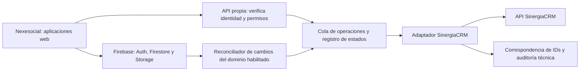

# Integración de Nexesocial con SinergiaCRM

Fecha: 21 de octubre de 2026. Base revisada: `main`, commit `96bed24e4da675fe1c00bc9c1b434388ad5ca682`.

## Decisión propuesta

Adoptar una integración gradual. Mantener Nexesocial como aplicación de intervención y operativa especializada; evaluar SinergiaCRM como núcleo de relaciones con personas y entidades, donaciones y subvenciones. No sustituir toda la plataforma ni copiar módulos PHP dentro del frontend Firebase.

La recomendación es arquitectónica y requiere validación funcional con la entidad. No se ha accedido a bases de datos, servicios desplegados ni a una instancia CRM. Se ha revisado código estático de Nexesocial y documentación oficial de SinergiaCRM. No se han ejecutado despliegues, migraciones o llamadas a producción. No es una auditoría completa de seguridad.

## 1. Lo que hay realmente en el repositorio

| Evidencia | Consecuencia para la integración |
|---|---|
| `firebase.json` publica `public/` y configura reglas e índices; no declara Functions | Hace falta incorporar un servicio servidor para la integración. La configuración revisada no demuestra la existencia de un backend externo. |
| `public/database.js:38` y siguientes escriben expedientes mediante transacciones desde el navegador | La UI está acoplada a Firestore e incluso al DOM. Sustituir el almacenamiento exige extraer una capa de acceso, pantalla por pantalla. |
| `public/grupos-db.js` usa `departamentos`, `actividades`, `grupos`, `beneficiarios_grupos` y `asistencia` | Conservar esta operativa inicialmente; no confundir una inscripción a un evento con una asistencia periódica. |
| `public/NexeAdmin/admin-donacions.html` observa `donants` y `donacions` | La captación es un candidato claro para probar el CRM sin comenzar por información clínica. |
| `public/caixaproinfancia.html` usa `cpi_familias` y subcolecciones `ajudes` y `documents` | CaixaProinfancia tiene estructura propia que debe preservarse hasta validar equivalencia funcional. |
| `public/NexePsy/nexepsy-db.js` usa rutas propias de pacientes e intervenciones | Evitar una importación basada únicamente en el documento de esquema. |
| `public/signature-flow.js` crea solicitudes y sesiones de firma; hay integración con AutoFirma | Reutilizar flujos y evidencias existentes. La equivalencia jurídica y técnica de otro sistema de firma no se presume. |
| `public/crypto-utils.js` implementa AES-GCM y una clave derivada de contraseña en el navegador | Un proceso servidor no podrá interpretar automáticamente los campos cifrados. Hace falta decidir qué se comparte y cómo. |
| `package.json` contiene pruebas de reglas, pero no un conector CRM | No existe una integración comprobada que pueda activarse con configuración. |

### Incidencias que condicionan la migración

1. **El esquema publicado no es un contrato fiable por sí solo.** `FIRESTORE_SCHEMA.md` muestra rutas como `/admin/personal/{empleadoId}` que no representan una ruta válida de documento Firestore, y omite estructuras presentes en código. Construir un catálogo a partir de escritores, lectores y reglas; después contrastarlo con una exportación autorizada de pruebas.
2. **Las sesiones de NexePsy tienen rutas inconsistentes.** En `SesionesDB.crear` y otros métodos se usa `nexepsy/intervenciones/${interventionId}/sesiones`: son cuatro segmentos, incompatibles con una referencia de colección. `listarProximas` consulta otra ruta de tres segmentos. Confirmar el modelo pretendido y corregir todos los consumidores conjuntamente. Una candidata coherente sería `nexepsy/intervenciones/intervenciones/{interventionId}/sesiones`, pero no debe imponerse sin inventariar datos existentes.
3. **El aislamiento clínico necesita revisión previa.** `firestore.rules:390` concede acceso a NexePsy mediante `canEditOperationalData`, que incluye roles operativos amplios. Es evidencia de autorización amplia en código, no una prueba de acceso en producción. Añadir pruebas de denegación por profesional, departamento y relación con el expediente antes de conectar nuevos consumidores. Revisar también el comodín recursivo final y la suma de permisos de todas las reglas coincidentes.
4. **No asumir que todo está cifrado.** `SECURITY_ENCRYPTION_MATRIX.md` describe una estrategia y fases, mientras `database.js` construye datos personales en claro. Verificar cada escritor y el estado real del backfill. Además, `decryptField` registra valores en consola: eliminar registros de contenido personal en un cambio separado, con revisión de consumidores.
5. **No se encontró una licencia de proyecto en los archivos rastreados.** Aclarar la licencia de Nexesocial antes de redistribuir una combinación de código. SinergiaCRM declara AGPL-3.0. La integración por API no resuelve por sí sola todas las cuestiones de licencia; no copiar código sin revisar sus condiciones.

## 2. Alternativas

| Alternativa | Ventaja | Coste o limitación | Valoración |
|---|---|---|---|
| Sustituir Nexesocial por SinergiaCRM | Un único núcleo CRM | Rehacer firma, CPI, clínica, asistencia, mantenimiento y experiencia de usuario | Descartar como primer paso |
| Integrar por API con responsabilidades definidas | Conserva inversiones y permite probar por dominio | Requiere conector, reconciliación y operación de dos sistemas | Recomendada |
| Mantener Nexesocial y añadir exportación periódica | Menor esfuerzo inicial | Información retrasada y trabajo manual | Válida como piloto de solo lectura |
| Copiar módulos SinergiaCRM dentro de Nexesocial | Aparente reutilización rápida | Arquitecturas distintas; acoplamiento, actualizaciones y licencia | No recomendable |

## 3. Arquitectura objetivo

El diagrama expresa una propuesta, no infraestructura existente. Para el piloto, empezar con un proceso de importación de datos sintéticos, sin lectores de producción. En integración continua, el reconciliador puede usar eventos servidor más barridos periódicos para recuperar cambios perdidos. Un navegador que escribe Firestore no garantiza por sí solo una outbox transaccional fiable.

El adaptador debe vivir fuera de `public/`, por ejemplo en Cloud Run o un servicio equivalente. Validar tokens Firebase en servidor y comprobar permisos por operación y registro; usar una identidad técnica CRM con privilegios mínimos. Las credenciales y sesiones CRM permanecen en un gestor de secretos y en servidor. Un SDK administrativo Firebase requiere sus propios controles: no queda protegido por las reglas del navegador.

La documentación oficial recomienda la API extendida `custom/service/v4_1_SticCustom/rest.php`. Verificar métodos, módulos y campos en la instalación de pruebas concreta. No presuponer API v8, OAuth, webhooks ni métodos de búsqueda extendidos sin comprobar disponibilidad.

### Propiedad de los datos

| Dominio | Durante el piloto | Objetivo tras aceptación |
|---|---|---|
| Personas y entidades | Nexesocial conserva autoridad; CRM recibe una copia de prueba | CRM podría ser maestro de identidad y contacto; Nexesocial mantiene IDs y proyección mínima |
| Donantes y donaciones | Importación unidireccional a sandbox | CRM maestro tras corte por dominio |
| Familias, expedientes, CPI, grupos y asistencia | Nexesocial maestro | Mantener; compartir solo campos acordados |
| Clínica, notas y genogramas | Nexesocial; excluidos del piloto | Segregación especializada; CRM recibe solo referencias o indicadores autorizados |
| Firma y documentos | Sistema de origen | Conservar originales, versiones, huellas y trazabilidad; referencias con acceso controlado |
| Usuarios y permisos | Firebase para Nexesocial; CRM para CRM | Vincular identidades cuando proceda; no copiar contraseñas ni equiparar roles automáticamente |

Definir propiedad **por campo**, no solo por entidad. Prohibir escritura simultánea del mismo campo en ambos sistemas. El cambio de maestro requiere bloquear o redirigir los formularios antiguos; una sincronización no resuelve dos editores concurrentes.

Para cada operación: `sourceSystem`, `sourcePath`, `sourceId`, `targetModule`, `targetId`, versión o huella de los campos compartidos, estado, intentos y `correlationId`. Clave de idempotencia por entidad y versión. Serializar por entidad; persistir correspondencias y reconciliar antes de repetir una creación cuyo resultado sea incierto. Un campo externo solo evita duplicados si se garantiza unicidad o exclusión mutua. Reintentos limitados con espera creciente y cola de fallos; no propagar borrados físicos durante el piloto. Los logs contienen IDs técnicos y códigos de error, nunca notas, documentos, credenciales o contenido personal.

## 4. Qué reutilizar y qué adaptar

Los destinos siguientes son candidatos funcionales. Los nombres internos de módulos y sus campos deben obtenerse de la instancia elegida; no son un mapeo ejecutable.

| Área | Reutilizar de SinergiaCRM | Conservar o adaptar en Nexesocial |
|---|---|---|
| Personas y entidades de la red | Contactos, organizaciones, relaciones y actividad CRM | Vinculación entre expediente, persona y familia; evitar convertir una familia en una empresa por conveniencia |
| Donaciones y socios | Base social, captación y procesos económicos aplicables | Reconciliar importes, estados, periodicidad y certificados antes de sustituir `admin-donacions.html` |
| Subvenciones y programas | Seguimiento de financiadores, convocatorias y proyectos donde encaje | Reglas de imputación, justificación y CPI requieren análisis de detalle |
| Eventos e inscripciones | Eventos y participantes | Horarios, grupos, listas y asistencia recurrente no son equivalentes directos |
| Tareas y comunicaciones | Seguimiento y campañas CRM | Aplicar segmentación y preferencias de comunicación acordadas |
| Documentos | Referencias y funciones documentales que se validen | Biblioteca y firma actuales; no duplicar enlaces públicos ni perder permisos |
| Psicología y genogramas | Solo relaciones y datos mínimos aprobados | Mantener NexePsy y genogramas; no migrar narrativas clínicas al contacto CRM |
| Auditoría de calidad y mantenimiento | Posibles tareas de seguimiento | NexeAudit, activos y mantenimiento siguen como módulos especializados |
| Personal y proveedores | Fichas de relación cuando aporten valor | No tratar el CRM como sustituto de nómina, control horario o contabilidad |

Reutilizar interfaces, plantillas y reglas funcionales de Nexesocial de forma selectiva. Extraer repositorios de datos de `database.js`, `grupos-db.js` y lógica embebida en HTML antes de cambiar su persistencia. En el CRM, preferir extensiones y módulos propios compatibles con su mecanismo de actualización, evitando modificar el núcleo.

## 5. Plan de migración

Estimación inicial: 7–12 semanas para un primer dominio aceptado, con dedicación técnica y funcional regular. Es un rango de planificación, no un presupuesto; depende de volumen, calidad, hosting y personalizaciones.

| Fase | Duración orientativa | Entrega y criterio para avanzar |
|---|---|---|
| Inventario y diseño | 1–2 semanas | Catálogo de rutas/campos, duplicados, matriz de permisos, propietario por campo y lista de exclusiones aceptados |
| Entorno aislado | 1 semana | Proyecto Firebase de pruebas distinto, sandbox CRM con versión fijada y datos sintéticos; sin secretos ni destinos de producción |
| Prueba de encaje | 1–2 semanas | Crear, consultar y relacionar contactos/entidades sintéticos; confirmar API, permisos y restricciones de módulos |
| Piloto de donaciones | 2–3 semanas | Importación repetible y reconciliada; validación funcional de donantes, importes, fechas y relaciones |
| Endurecimiento y ensayo | 1–2 semanas | Pruebas de fallos, reintentos, permisos, conciliación y restauración satisfactorias |
| Corte limitado | 1–2 semanas | Solo tras autorización posterior: congelar escrituras del dominio, importar delta, verificar y habilitar al equipo piloto |

Secuencia: catálogos y entidades → personas → relaciones → operaciones del dominio → documentos autorizados. Preservar el ID Firestore como referencia externa, sin usar DNI o email como clave universal. Detectar duplicados y someter coincidencias ambiguas a revisión humana. Normalizar estados mediante tabla explícita, fechas con zona horaria acordada e importes con moneda y precisión fija. Conservar valores desconocidos como incidencias, sin rellenarlos por deducción.

La primera iteración debe usar 20–50 casos sintéticos que cubran duplicados, entidades, donantes individuales, fechas límite y registros incompletos. Los datos reales requieren una extracción autorizada y minimizada; no adjuntar exportaciones al repositorio ni a una PR.

### Criterios de aceptación

- Conteos de entrada = migrados + excluidos justificados + errores explícitos; cero pérdidas silenciosas.
- Segunda ejecución sin nuevos duplicados; reconciliación tras caída entre escritura CRM y guardado de correspondencia.
- Relaciones sin referencias huérfanas y revisión de homónimos sin fusión automática.
- Importes conciliados por moneda y periodo; fechas y estados contrastados con los casos funcionales.
- Pruebas de denegación para usuarios ajenos al registro, departamento o función clínica.
- Timeout, sesión caducada, límite de API y respuesta malformada gestionados sin exponer datos.
- Restauración de sandbox ensayada; mecanismo de parada y cola de operaciones pendientes revisados.

### Reversión

Durante el piloto Nexesocial sigue siendo maestro: detener el conector y conservar su estado permite continuar la operativa. Tras un eventual cambio de maestro, no basta con restaurar una copia antigua: hay que capturar y conciliar las operaciones nuevas del CRM antes de volver a habilitar escrituras en Nexesocial. No borrar orígenes hasta cumplir la política de conservación y cerrar la conciliación. El despliegue real y cualquier acceso a producción quedan fuera de este trabajo.

## 6. Cifrado y acceso como decisiones de diseño

No subir claves del navegador al servicio de integración. Si se necesitan campos cifrados, elegir explícitamente entre exportación controlada por una persona autorizada, rediseño de custodia de claves, o exclusión de esos campos. Copiar texto descifrado a un CRM cambia el perímetro de protección y debe ser una decisión expresa. El piloto no necesita datos clínicos.

Separar permisos de la aplicación, de la identidad técnica y del usuario CRM. Compartir una cuenta técnica no debe convertirla en una vía para saltarse la autorización del solicitante. Acordar con los responsables internos qué datos, plazos de conservación y accesos son necesarios antes de usar datos reales.

## 7. Cambios propuestos y estado de entrega

Esta rama incorpora únicamente este informe. No se añade todavía un conector porque faltan versión e instalación CRM, contrato de campos, autoridad por campo y política de cifrado. Implementarlo ahora obligaría a inventar condiciones esenciales.

Orden recomendado de PRs posteriores:

1. Corregir rutas de sesiones y actualizar el esquema, con pruebas de referencias y reglas en emulador.
2. Revisar aislamiento de NexePsy y retirar logs con datos personales, con pruebas de acceso negativo.
3. Añadir un transformador offline con esquema validado, lista permitida de campos y casos sintéticos; cero red y cero escritura por defecto.
4. Añadir adaptador servidor y prueba contractual contra sandbox con identidad limitada, secretos externos y destinos permitidos.
5. Integrar el primer dominio con la UI una vez aceptada la conciliación.

Validación de esta entrega: lectura de fuentes, contraste de rutas y configuración, y revisión del diff documental. No se han ejecutado pruebas funcionales ni de seguridad: no cambia código ejecutable. No se ha publicado rama remota ni abierto una PR.

## 8. Fuentes y límites

- [Nexesocial, instantánea revisada](https://github.com/rcampos-naum/Nexesocial/tree/96bed24e4da675fe1c00bc9c1b434388ad5ca682). Las evidencias de archivos anteriores se refieren a esta instantánea.
- [SinergiaCRM: repositorio oficial](https://github.com/SinergiaTIC/SinergiaCRM): base SuiteCRM y licencia AGPL-3.0. Se consultó documentación y estructura web; no se instaló ni se probó su código.
- [Acceso al CRM vía API](https://wiki.sinergiatic.org/index.php?title=Acceso_al_CRM_v%C3%ADa_API): endpoint extendido v4.1 y aplicación de roles/grupos de seguridad al usuario API.
- [Ejemplos oficiales de API](https://github.com/SinergiaTIC/SinergiaCRM-API-Examples): referencia para el futuro piloto.
- [Descripción funcional oficial](https://www.sinergiatic.org/es/sinergiacrm/): base social, atención directa, subvenciones, inserción laboral e integración. La disponibilidad concreta depende de instalación y configuración.

Pendiente de confirmar: volumen real, datos efectivamente cifrados, versión/hosting CRM, módulos instalados, límites de API, requisitos de actualización, responsables funcionales y presupuesto. La rama local solo representa el estado actual de GitHub; no incluye posibles cambios existentes en otros equipos o ramas.
